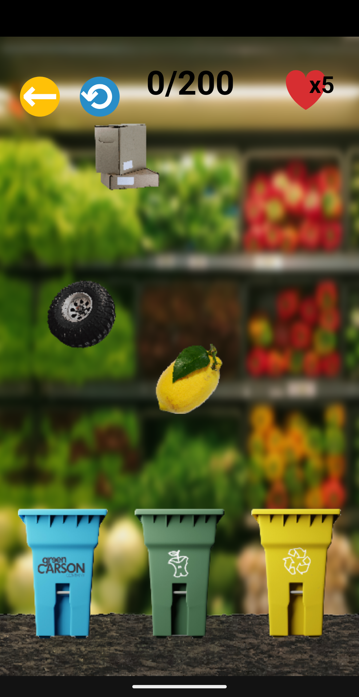

# Green Carson - Reecicla! GAME

Android Studio video game about recycling and waste sorting, made in collaboration with ITESM and Green Carson.

Developed from September 22 to December 1, 2023; delivered to the organization on December 1, 2023.

## iOS Version

The repository for the iOS version of the mobile game can be found in its [corresponding repository](https://github.com/GhulRasal/E4_AppGreenCaron_iOS/).

### iOS Developers

[José Luis Zago Guevara](https://github.com/GhulRasal)

[Christian Flores Alberto](https://github.com/christian1444)

## Android Version

The current repository corresponds to the Android Studio development of the mobile game.

### Android Developers

[César Guerra Martínez](https://github.com/CesarGMtz)

[Alejandro Daniel Moctezuma Cruz](https://github.com/AlejandroMoc)
